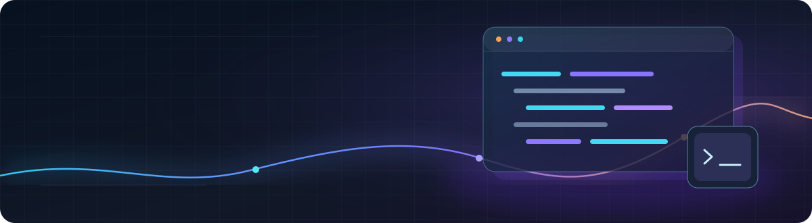

# Hi, I’m Rabea Shaban

### Full-Stack Software Engineer · MERN · Next.js · AWS

I design, build, and deploy end-to-end web products — from responsive interfaces and APIs to databases and cloud infrastructure.

---

## About Me

- Freelance Full-Stack Software Engineer, working with regional and international clients since **2023**.
- Build complete web applications with **React, Next.js, Node.js, Express, and MongoDB**.
- Extend products with cloud infrastructure and delivery workflows using **AWS, Docker, Kubernetes, and CI/CD**.
- Based in **Egypt**; especially interested in reliable products, clean architecture, and thoughtful user experiences.

## Tech Stack

**Frontend**  

**Backend & Data**  

**Cloud, DevOps & Observability**  

## Selected Projects

<table>
  <tr>
    <td width="50%" valign="top">
      <h3>EduSphere</h3>
      
A full-stack learning platform for students, teachers, and administrators, with course management, live sessions, assessments, certificates, and payments.

      <a href="https://edusphere-theta-woad.vercel.app/">Live demo</a> ·
      <a href="https://github.com/rabea-shaban/EduSphere">Source</a>
        
      Next.js · React · TypeScript · Node.js · MongoDB · Socket.IO · Stripe
    </td>
    <td width="50%" valign="top">
      <h3>Pharmacy POS</h3>
      
A multi-branch pharmacy operations and point-of-sale system for inventory, checkout, staff access, and reporting.

      <a href="https://pharmacy-pos-pharmacy-pos-frontend-ten.vercel.app/#/login">Live demo</a> ·
      <a href="https://github.com/rabea-shaban/-PHARMACY-POS">Source</a>
        
      React · TypeScript · Node.js · Express · Prisma · MySQL
    </td>
  </tr>
  <tr>
    <td width="50%" valign="top">
      <h3>Zein Hub</h3>
      
A learning and media platform for training programs, lessons, live sessions, assignments, attendance, and certificates.

      <a href="https://zein-hub.vercel.app/">Live demo</a> ·
      <a href="https://github.com/rabea-shaban/Zein-Hub">Source</a>
        
      Next.js · React · TypeScript · Node.js · Express · MongoDB
    </td>
    <td width="50%" valign="top">
      <h3>Sy2antek</h3>
      
A vehicle service platform connecting customers with mechanics, including service booking and operations dashboards.

      <a href="https://sy2antek.vercel.app/">Live demo</a> ·
      <a href="https://github.com/rabea-shaban/Sa2yanti">Source</a>
        
      React · TypeScript · Node.js · Express · MongoDB
    </td>
  </tr>
</table>

## Education & Certifications

- **AI-Based Software Development Specialized Diploma** — Digilians / MCIT, completed with distinction (2026)
- **AWS Certified Developer – Associate** (2026)
- **AWS Certified Cloud Practitioner** (2026)
- **Meta Front-End Developer Professional Certificate** (2024–2026)
- **B.Sc. in Management Information Systems** — Higher Institute of Technology, Management & Information, Minya; graduated with distinction (2024)

## بالعربي

أنا ربيع شعبان، مهندس برمجيات Full-Stack أعمل بشكل مستقل منذ 2023. أطور تطبيقات ويب متكاملة باستخدام React وNext.js وNode.js وMongoDB، وأهتم بتصميم تجربة الاستخدام، بناء الـAPIs، ونشر الأنظمة على AWS. أعمل على منتجات تعليمية وتجارية وأنظمة خدمات، مع اهتمام بجودة الكود وقابلية التوسع.

---

  Building dependable products with thoughtful engineering.

